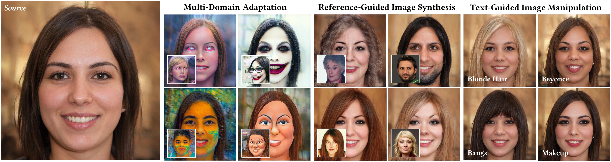

**HyperGAN-CLIP: A Unified Framework for Domain Adaptation, Image Synthesis and Manipulation.** SIGGRAPH Asia 2024. I'm the first author and the project's contact author, and the official PyTorch code lives on my GitHub.

## The problem

A pretrained StyleGAN makes very realistic faces. But pointing it at a new job, like a new art style from one reference image or an edit described in words, usually means training a separate model for each domain. And text-guided editing usually wants text-specific training data.

## The idea

Instead of training new generators, I bolt small hypernetwork modules onto one pretrained StyleGAN. They read a reference image or a text prompt and adjust the generator's weights to match, which brings CLIP's image and text space into the generator.

- The adjusted weights are blended with the original features, so the source image keeps its identity.
- A CLIP-guided discriminator pushes the generated images to match the target domain.
- The latent mapper stays untouched, so existing latent-space editing methods such as InterfaceGAN still work on top.

## What one model can do

- One-shot and few-shot domain adaptation, across many domains at once.
- Domain mixing: blend two target domains by averaging and re-scaling their CLIP embeddings.
- Semantic edits inside the new domain: age, smile, pose.
- Reference-guided and text-guided synthesis and manipulation of real images, with no text-specific training data.

## Credit

The codebase builds on DynaGAN (Kim et al., SIGGRAPH Asia 2022), as the repository's README says. Co-authors: Ahmet Canberk Baykal, Muhammed Burak Kizil, Duygu Ceylan, Erkut Erdem and Aykut Erdem.
